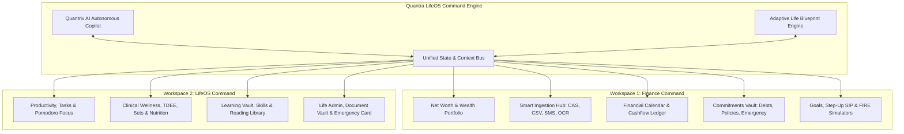
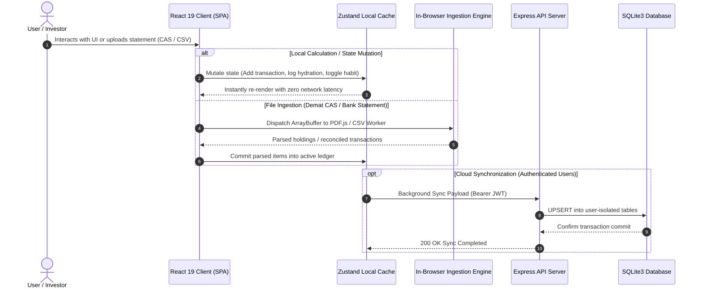
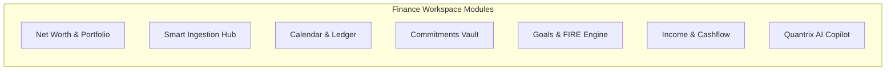
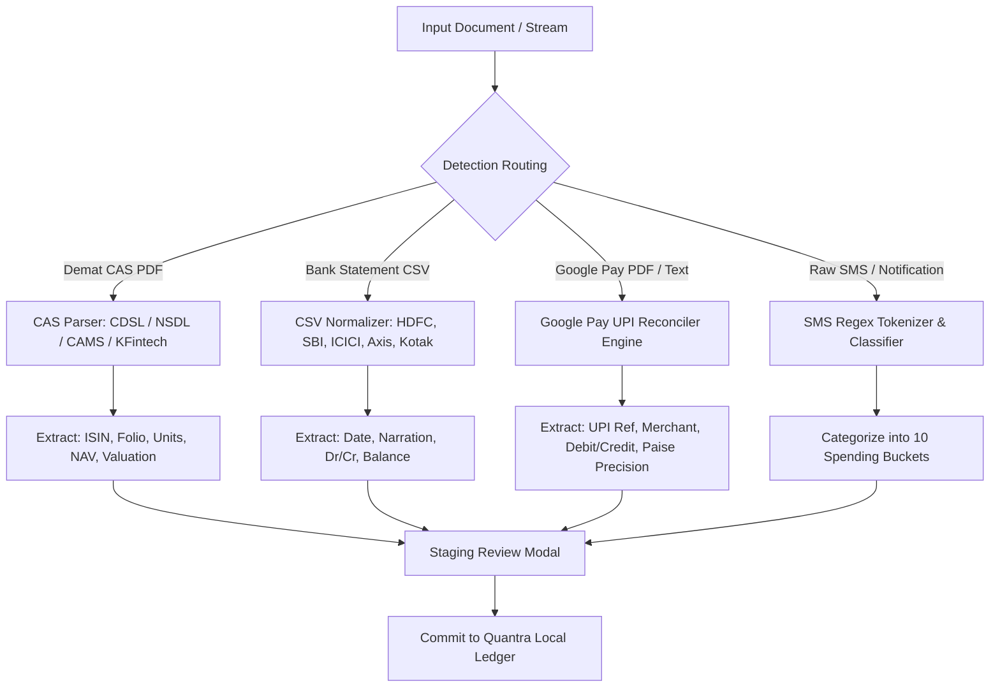
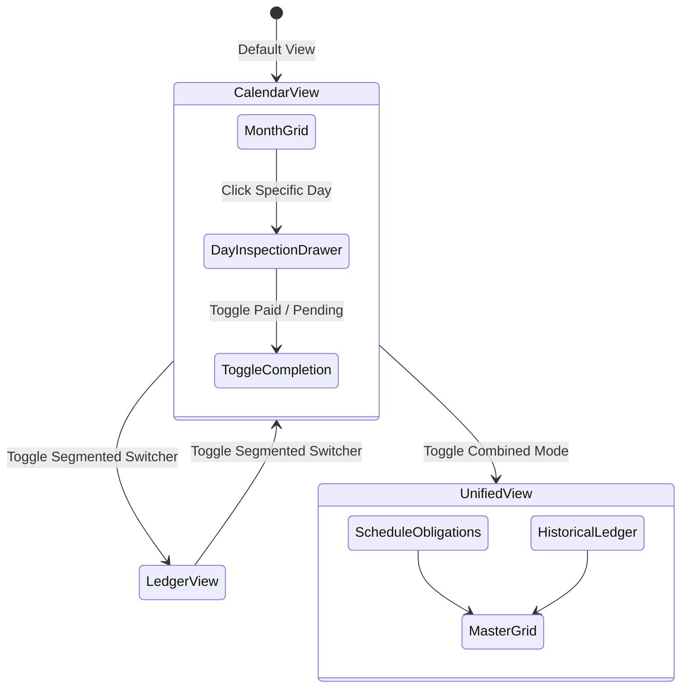
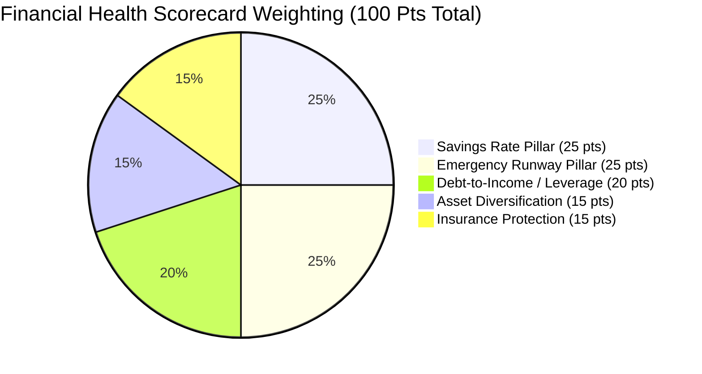
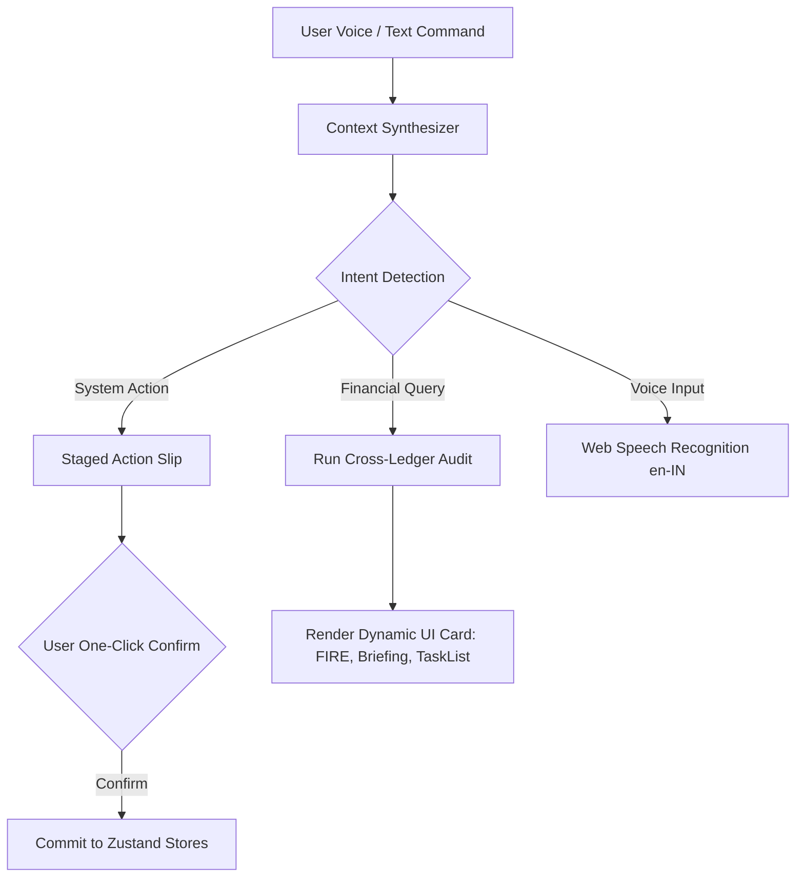
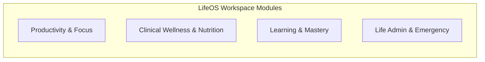
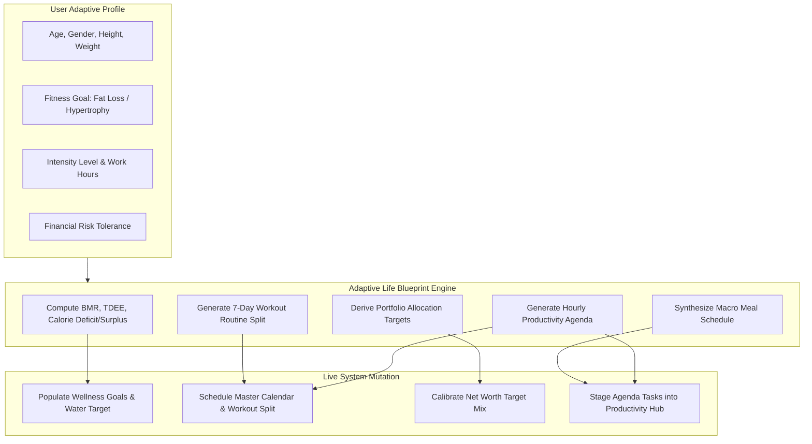

# Quantra LifeOS — Comprehensive Application & Feature Documentation

> **Version:** 2.0.0  
> **Classification:** Technical Architecture, Feature Specifications & Operational Manual  
> **Repository:** `finpulse-finance-app` (Quantra LifeOS Command Centre)  
> **Deployment Target:** Web SPA (Vercel) + Backend REST API (Node/Express/SQLite) + Mobile (Android Capacitor)

---

## 1. Executive Summary & System Overview

**Quantra LifeOS** is a holistic, local-first personal command center uniting high-grade financial engineering, clinical nutrition and physical conditioning, deep work productivity, continuous skill mastery, and critical life administration into a unified, high-performance operational hub.

Unlike conventional fragmented applications where financial tracking is divorced from daily health habits and career execution, Quantra LifeOS operates on the principle that **financial capital, physical vitality, time allocation, and life resilience form a deeply coupled equilibrium**.



### 1.1 Key Highlights & Differentiators

1. **Complete Cross-Domain Visibility:** Real-time synchronization between financial obligations (loan EMIs, insurance renewals, SIP debits) and the daily agenda master calendar.
2. **100% On-Device Financial Ingestion:** Native, zero-cloud Demat CAS (CDSL/NSDL/CAMS/KFintech) PDF parsers, bank statement CSV normalizers, and Google Pay UPI statement reconcilers operating client-side with zero data leaks.
3. **Rigorous Clinical & Financial Mathematics:** Implements peer-reviewed biometric models (Mifflin-St Jeor, PAL multipliers, macronutrient partitioning) and quantitative wealth algorithms (Amortized debt schedules, Avalanche/Snowball prioritization, Step-Up SIP simulations, and multi-tier FIRE calculations).
4. **Quantrix AI Copilot:** A context-aware assistant capable of executing system commands, logging water, staging financial trades, scheduling agenda tasks, and running financial audits through natural voice or text interactions.
5. **Local-First with Hybrid Cloud Persistence:** Immediate UI updates via Zustand reactive stores, persisting to local storage and mirroring into an isolated multi-tenant SQLite database via authenticated REST APIs.

---

## 2. Global Architecture & Platform Foundations

### 2.1 Technology Stack Matrix

| Layer | Technologies | Primary Responsibilities |
| :--- | :--- | :--- |
| **Frontend Framework** | React 19, TypeScript 5.8 | Component rendering, hooks architecture, high-frequency reactive updates |
| **Styling & Motion** | TailwindCSS v4, Framer Motion, Lucide Icons | Responsive luxury aesthetic, animated transitions, glassmorphic UI |
| **State Management** | Zustand (with `persist` middleware) | Reactive client-side stores (`financeStore`, `lifeosStore`, `authStore`, `masteryStore`) |
| **Data Visualization** | Recharts, SVG Canvas | Asset allocation donuts, interactive portfolio curves, cash flow bar charts, FIRE milestone projections |
| **Client Ingestion** | PDF.js (Legacy build), Web Workers | On-device PDF extraction, PAN-password decryption, CSV string normalization |
| **Backend Runtime** | Node.js, Express, TypeScript | Headless REST API routing, request validation, authentication middleware |
| **Embedded Database** | SQLite 3 (`sql.js` WASM engine) | Single-file portable relational persistence, foreign key cascading, zero latency |
| **Mobile Runtime** | Capacitor 7, Android Native Bridge | Cross-platform WebView container, hardware back-button handling, safe-area insets |

### 2.2 System Topology & Data Flow



### 2.3 User Isolation & Authentication Subsystem

Quantra LifeOS enforces strict separation between unauthenticated demonstration exploration and persistent user accounts:

- **Demo Experience Mode:** Allows users to test the application with realistic pre-populated portfolios, loan ledgers, fitness logs, and emergency cards. All mutations are stored in isolated local demo namespaces (`finpulse_user_demo_*`).
- **Authenticated Account Mode:**
  - Secure signup and login endpoints (`/api/auth/register`, `/api/auth/login`).
  - Passwords hashed using `bcryptjs` with salt rounds $10$.
  - Stateless JSON Web Tokens (JWT) signed with `JWT_SECRET`, expiring after 7 days.
  - Multi-account isolation: The Express middleware (`authenticateUser`) extracts `req.userId` and validates it against every query, preventing cross-user data leakage.
  - Client storage dynamically routes data to user-specific keys: `finpulse_user_<userId>_finance_v2` and `finpulse_user_<userId>_lifeos_v2`.

### 2.4 Multi-Currency Engine

Quantra supports seamless tri-currency conversion across:
1. **₹ INR (Indian Rupee):** Base locale `en-IN`, using standard Lakhs ($10^5$) and Crores ($10^7$) notation.
2. **$ USD (US Dollar):** Base locale `en-US`, standard Million ($10^6$) and Billion ($10^9$) units.
3. **د.إ AED (UAE Dirham):** Base locale `ar-AE`, pegged conversion rates.

All internal calculations in the finance ledger anchor to USD base values with floating conversion rates configured in `CURRENCY_CONFIGS`:
$$\text{Display Amount} = \text{Amount}_{\text{USD}} \times \text{Rate}_{\text{Currency}}$$
Formatting functions (`formatCurrency`, `formatCompactNumber`) automatically apply appropriate grouping separators (e.g., `12,34,567.00` for INR vs `1,234,567.00` for USD).

### 2.5 Mobile Android Capacitor Infrastructure

Quantra LifeOS is fully configured for native Android execution:
- **Application ID:** `app.quantra.lifeos`
- **Application Name:** *Quantra Life OS*
- **Android Capabilities:** Hardware back-button listeners, edge-to-edge status bar theming, touch-optimized hit areas ($44\text{px}$ minimum), and responsive navigation adapting between a desktop collapsible sidebar and an ergonomic mobile bottom navigation bar (`MobileBottomNav.tsx`).

---

## 3. Finance Workspace Features

The **Finance Workspace** (`FinanceWorkspace.tsx`) is designed for retail investors, HNIs, and wealth builders who require a consolidated institutional-grade view of their assets, liabilities, cashflows, and long-term milestones.



---

### 3.1 Net Worth & Wealth Portfolio Engine

The wealth management engine consolidates multi-asset classes into a single real-time valuation matrix.

#### Supported Asset Classes & Typology
- **EQUITY:** Listed Indian (NSE/BSE) and US (NASDAQ/NYSE) equities.
- **MUTUAL_FUNDS:** Active, passive index, flexi-cap, and tax-saving ELSS funds.
- **FIXED_DEPOSIT:** Bank term deposits with maturity tracking and fixed APR.
- **GOLD_SGB:** Sovereign Gold Bonds, digital gold, and physical bullion.
- **REAL_ESTATE:** Commercial real estate, residential property, and agricultural land.
- **RETIREMENT_PPF:** Public Provident Fund (PPF), Employee Provident Fund (EPF), and National Pension System (NPS).
- **BONDS_DEBT:** Sovereign debt, corporate bonds, and debentures.
- **STARTUP_EQUITY:** Angel allocations and unlisted private equity.
- **CRYPTO:** Major digital assets (Bitcoin, Ethereum, Solana).
- **LIQUID_CASH:** High-yield savings balances, sweep-in accounts, and emergency cash reserves.

#### Mathematical Formulations

1. **Individual Asset Current Market Value:**
   $$V_{\text{current}} = Q \times P_{\text{market}}$$
2. **Individual Asset Invested Value:**
   $$V_{\text{invested}} = Q \times P_{\text{avg\_buy}}$$
3. **Gross Asset Value:**
   $$V_{\text{gross}} = \sum_{k=1}^{N} (Q_k \times P_{\text{market}, k})$$
4. **Total Debt Liabilities:**
   $$D_{\text{total}} = \sum_{j=1}^{M} D_{\text{outstanding}, j}$$
5. **Net Worth:**
   $$\text{Net Worth} = V_{\text{gross}} - D_{\text{total}}$$
6. **Total Unrealized P&L and Percentage:**
   $$\Delta_{\text{PnL}} = V_{\text{gross}} - V_{\text{invested}}$$
   $$\%\Delta_{\text{PnL}} = \begin{cases} \left(\frac{\Delta_{\text{PnL}}}{V_{\text{invested}}}\right) \times 100 & \text{if } V_{\text{invested}} > 0 \\ 0 & \text{otherwise} \end{cases}$$

#### Asset Allocation Donut (`AllocationDonut.tsx`)
Visualizes current capital distribution against target allocation boundaries. Categories are assigned distinctive luxury themes:
- Equity: Imperial Navy (`#17365d`)
- Mutual Funds: Emerald Green (`#059669`)
- Real Estate: Terra Cotta (`#c2410c`)
- Gold & SGBs: Sovereign Gold (`#9e783e`)
- Liquid Cash: Cool Slate (`#475569`)

#### Listed Stock Directory & Search (`stockSearchService.ts`)
Features a built-in search engine indexing blue-chip stocks (Reliance, TCS, HDFC Bank, Infosys, Apple, Microsoft, Google, Nvidia) allowing users to add holdings with auto-filled ticker symbols, prevailing prices, and exchange metadata.

---

### 3.2 Smart Ingestion Hub

The **Smart Ingestion Hub** (`SmartIngestionHubModal.tsx`) solves the manual entry bottleneck by providing zero-knowledge client-side ingestion across multiple financial formats.



#### 1. Demat CAS (Consolidated Account Statement) Parser (`casStatementService.ts`)
- **Supported Issuers:** Central Depository Services Ltd (CDSL), National Securities Depository Ltd (NSDL), Computer Age Management Services (CAMS), KFintech.
- **Automated Password Decryption:** Automatically attempts decryption using standard Indian depository password patterns (PAN Upper/Lower Case, Date of Birth combinations) via `pdfExtractorService.ts`.
- **Extracted Fields:** Folio numbers, ISIN codes, scheme names, unit quantities, weighted average purchase cost, current NAV, and total market valuation.

#### 2. Bank Statement CSV Parser (`bankStatementService.ts`)
- **Supported Banks:** HDFC Bank, State Bank of India (SBI), ICICI Bank, Axis Bank, and Kotak Mahindra Bank.
- **Dynamic Header Detection:** Identifies header rows even when preceded by metadata banners by scanning for combinations of `['date', 'narration', 'withdrawal', 'deposit', 'balance']`.
- **Paise Sanitization:** Cleans quoted strings, currency prefixes, and commas to prevent precision loss.

#### 3. Google Pay UPI Statement Parser (`gpayStatementService.ts`)
- **Statement Verification:** Detects official Google Pay export headers (`UPI Transaction ID`, `Paid to`, `Received from`).
- **Paise Reconciler:** Validates that total debits and credits match reported aggregate turnover down to the last paise.
- **Account Isolation:** Separates bank account UPI debits from RuPay Credit Card UPI transactions and identifies non-expense self-transfers between user accounts.

#### 4. SMS & Notification Scanner (`smsParserService.ts`)
- Evaluates transactional SMS text patterns from Indian banking shortcodes (e.g., `VK-HDFCBK`, `AD-ICICIB`, `AX-SBIINB`).
- Automatic merchant classification across 10 granular spending buckets: `FOOD_DINING`, `SHOPPING_LIFESTYLE`, `TRAVEL_COMMUTE`, `UTILITIES_BILLS`, `HEALTHCARE_INSURANCE`, `ENTERTAINMENT_SUBS`, `EDUCATION`, `HOUSING_RENT`, `EMI_LOANS`, and `OTHER_EXPENSE`.

---

### 3.3 Financial Calendar & Transactions Ledger

The **Financial Calendar & Ledger** (`CalendarLedgerManager.tsx`, `FinancialCalendarWidget.tsx`, `TransactionTable.tsx`) combines forward-looking financial obligations with backward-looking transaction verification.



#### Event Typology & Color Coding
- **PLANNED_EXPENSE:** Utility bills, rent obligations, property tax (`#dc2626` Crimson).
- **PLANNED_INVESTMENT:** Monthly SIP deductions, stock purchase reserves (`#16836b` Teal / Emerald).
- **LIFE_EVENT:** Birthdays, festivals, family vacations (`#7c3aed` Violet).
- **MEDICAL_CHECKUP:** Scheduled doctor appointments, dental visits, diagnostics (`#d97706` Amber).
- **EXPECTED_INCOME:** Salary credit, dividend payouts, rental receipts (`#059669` Green).

#### Dynamic Cashflow Projection Formula
For any given month $M$:
$$\text{Projected Inflows} = \sum E_{\text{amount}} \quad \forall E \in \text{EXPECTED\_INCOME}$$
$$\text{Projected Outflows} = \sum E_{\text{amount}} \quad \forall E \notin \text{EXPECTED\_INCOME}$$
$$\text{Net Cashflow} = \text{Projected Inflows} - \text{Projected Outflows}$$

#### Secondary Dynamic Filtering Subsystem
The Financial Calendar includes a two-stage drill-down architecture:
1. **Primary Filter:** Selects active time horizon (`THIS_MONTH`, `NEXT_30_DAYS`, `NEXT_90_DAYS`, `CUSTOM_RANGE`) combined with event type or spending category.
2. **Dynamic Secondary Filter:** Dynamically parses all events matching the primary filter, extracts unique merchant/entity names (e.g., Swiggy, Amazon, HDFC Home Loan, Parag Parikh SIP), computes their specific monetary volumes and occurrence frequencies, and creates a secondary filter dropdown.
3. **Interactive Visualizations:**
   - **Pie/Donut Distribution:** Slices expenses by counterparty with interactive hover tooltips.
   - **Horizontal Bar Chart:** Ranks merchants by spend volume with custom tick truncation and absolute currency labels.

---

### 3.4 Commitments Vault & Liability Management

The **Commitments Vault** (`CommitmentsVaultManager.tsx`) brings liabilities and risk management into a unified command dashboard.

#### 1. Debt & Loan Repayment Manager (`DebtRepaymentManager.tsx`)
- **Liabilities Tracked:** Home loans, vehicle loans, education loans, personal loans, credit card balances, and peer debts.
- **Payoff Strategy Engine:**
  - **Debt Avalanche (Mathematical Optimization):** Orders liabilities in descending order of interest rate ($r_1 \ge r_2 \ge \dots \ge r_k$), directing excess capital to the highest-cost debt first to minimize total interest paid.
  - **Debt Snowball (Behavioral Psychology):** Orders liabilities in ascending order of outstanding principal ($P_1 \le P_2 \le \dots \le P_k$), knocking out small balances first for motivational wins.
- **Amortization & Freedom Date Formula:**
  Given total outstanding balance $P$, monthly interest rate $r = \frac{\text{APR}}{12 \times 100}$, and total monthly EMI payment $E$:
  $$n = -\frac{\ln\left(1 - \frac{P \cdot r}{E}\right)}{\ln(1 + r)}$$
  Where $n$ represents the remaining months to complete debt freedom.

#### 2. Insurance Policies Vault (`InsuranceManager.tsx`)
- **Policy Classification:** Term Life, Family Health Floater, Critical Illness, Motor Vehicle, and Homeowners Insurance.
- **Policy Metadata:** Sum assured, annual premium, policy number, cashless hospital count, and Third-Party Administrator (TPA) emergency helpline.
- **Automated Calendar Linkage:** Annual renewal dates automatically inject reminder events into the Financial Calendar 30 days prior to expiry.

#### 3. Emergency Vault & Financial Health Scorecard (`EmergencyVaultHealthScore.tsx`)
Evaluates total financial resilience on an objective $100$-point diagnostic score across 5 weighted pillars:



| Pillar | Max Score | Scoring Criteria |
| :--- | :---: | :--- |
| **Savings Rate** | 25 | $\ge 40\%$ (25 pts) \| $\ge 25\%$ (20 pts) \| $\ge 15\%$ (15 pts) \| $> 0\%$ (10 pts) \| $\le 0\%$ (5 pts) |
| **Emergency Runway** | 25 | $\ge 6\text{ months}$ (25 pts) \| $\ge 4\text{ months}$ (20 pts) \| $\ge 2\text{ months}$ (12 pts) \| $< 2\text{ months}$ (5 pts) |
| **Debt-to-Income (DTI)** | 20 | Zero Debt (20 pts) \| $\text{DTI} \le 20\%$ (20 pts) \| $\le 35\%$ (15 pts) \| $\le 50\%$ (8 pts) \| $> 50\%$ (3 pts) |
| **Diversification** | 15 | $\ge 4\text{ asset classes}$ (15 pts) \| $3\text{ classes}$ (12 pts) \| $2\text{ classes}$ (8 pts) \| $1\text{ class}$ (4 pts) |
| **Insurance Protection**| 15 | Term Life + Health Floater active (15 pts) \| Health only (8 pts) \| Life only (7 pts) \| None (0 pts) |

**Composite Health Rating:**
- $\ge 85$: **EXCELLENT** (Institutional-grade resilience)
- $70 - 84$: **GOOD** (Solid fundamentals with minor optimizations needed)
- $50 - 69$: **FAIR** (Vulnerable to severe financial shocks)
- $< 50$: **NEEDS_ATTENTION** (High financial vulnerability)

---

### 3.5 Goals, Milestones & Compound Wealth Simulators

#### 1. Goal Bucketing (`GoalMilestoneManager.tsx`)
Enables goal-based investing across Retirement, Higher Education, Home Purchase, Vehicle, Vacation, and Wealth Accumulation.

- **Inflation-Adjusted Target Formula:**
  $$FV = PV \times (1 + r_{\text{inflation}})^t$$
  Where $PV$ is current target cost, $r_{\text{inflation}}$ is expected annual inflation rate, and $t$ is years to target date.
- **Required Monthly SIP Calculation:**
  Given required future value $FV$, current saved capital $S_0$, and expected monthly return $i = \frac{r_{\text{return}}}{12 \times 100}$ over $n = 12 \times t$ months:
  $$\text{Deficit} = FV - S_0 \times (1 + i)^n$$
  $$\text{Required Monthly SIP} = \frac{\text{Deficit} \times i}{\left((1 + i)^n - 1\right) \times (1 + i)}$$

#### 2. SIP & Step-Up Compounding Simulator (`SipCalculator.tsx`)
Calculates the exponential acceleration of regular SIP contributions with optional annual percentage step-ups:
- **Standard SIP Future Value:**
  $$FV = P \times \left[\frac{(1 + i)^n - 1}{i}\right] \times (1 + i)$$
- **Annual Step-Up SIP Simulation:** Escalates contribution $P_k = P_0 \times (1 + s)^k$ every 12 months, delivering substantially higher wealth accumulation over 10-25 year horizons.

#### 3. Advanced FIRE (Financial Independence, Retire Early) Calculator (`FireCalculatorWidget.tsx`)
Automates calculations across 5 FIRE variants using live ledger expenses:
1. **Standard FIRE:** Corpus equals annual expenses divided by Safe Withdrawal Rate (SWR, typically 4% or 25x expenses):
   $$\text{Corpus}_{\text{Standard}} = \frac{\text{Annual Expenses}}{\text{SWR}} = 25 \times \text{Annual Expenses}$$
2. **Lean FIRE:** Minimalist baseline retirement corpus ($75\%$ of Standard FIRE).
3. **Fat FIRE:** Abundant lifestyle retirement corpus ($150\%$ of Standard FIRE).
4. **Barista FIRE:** Partial independence requiring 50% passive corpus coverage with part-time work covering the remaining 50%.
5. **Coast FIRE:** Corpus size required *today* that will compound to full retirement corpus at age 60 with zero further contributions:
   $$\text{Corpus}_{\text{Coast}} = \frac{\text{Corpus}_{\text{Standard}}}{(1 + r_{\text{real}})^{60 - \text{Current Age}}}$$
   Where $r_{\text{real}} = \frac{1 + r_{\text{return}}}{1 + r_{\text{inflation}}} - 1$.

---

### 3.6 Monthly Income & Budget Allocation Engine

The budget engine (`CashFlowVisualizationCard.tsx`) tracks live cashflow velocities:
- **Net Savings Velocity:**
  $$\text{Savings Rate} = \left(\frac{\text{Income}_{\text{Monthly}} - \text{Expenses}_{\text{Monthly}}}{\text{Income}_{\text{Monthly}}}\right) \times 100$$
- **Liquid Runway Months:**
  $$\text{Runway} = \frac{\text{Liquid Cash Reserves}}{\text{Average Monthly Expenses}}$$
- **Subscription & Recurring Bill Scanner:** Employs string similarity heuristics to isolate recurring Netflix, Spotify, gym, and broadband debits, presenting renewal countdowns and cancellation opportunities.

---

### 3.7 Quantrix AI Copilot

**Quantrix** (`quantrixEngine.ts`, `FloatingAiChatWidget.tsx`, `AiWealthCopilot.tsx`) is Quantra’s autonomous conversational copilot.



#### Functional Capabilities
1. **Natural Voice Mode:** Seamless browser speech recognition (`webkitSpeechRecognition`) tuned with Indian English locale (`en-IN`) for hands-free queries.
2. **Autonomous Command Staging:** Converts natural language into staged confirmation slips:
   - *"Drank 500ml water"* $\to$ Stages `LOG_WATER` (+0.5L)
   - *"Did 45 min chest workout"* $\to$ Stages `LOG_WORKOUT` (45 mins)
   - *"Buy 10 shares of Reliance at 2950 on Zerodha"* $\to$ Stages `TRADE` action slip
   - *"Remind me to file GST on 20th"* $\to$ Stages `CREATE_TASK` on agenda
3. **Interactive UI Card Rendering:** Responds with specialized cards:
   - `FIRE_GAUGE`: Interactive gauge of retirement progress
   - `BRIEFING`: Morning executive overview of tasks, net worth change, and pending bills
   - `TASK_LIST`: Interactive checkboxes to complete agenda items directly in chat
   - `ACTION_SLIP`: High-contrast confirmation button with instant XP reward trigger

---

## 4. LifeOS Workspace Features

The **LifeOS Workspace** unifies personal discipline, biological vitality, intellectual growth, and household administrative security.



---

### 4.1 Productivity & Task Execution

The **Productivity Workspace** (`ProductivityWorkspace.tsx`) governs daily output and focus.

#### 1. Task Management & Prioritization
- **Granular Categories:** `PRODUCTIVITY`, `FINANCE`, `WELLNESS`, `LEARNING`, `LIFEADMIN`.
- **Urgency Levels:** `HIGH` (Immediate attention), `MEDIUM` (Standard priority), `LOW` (Backlog).
- **Gamified Rewards:** Completing high-priority tasks yields $+20$ to $+35$ Mastery XP in the respective domain.

#### 2. Eisenhower Matrix Framework
Organizes tasks across four decision quadrants:
1. *Urgent & Important (Do First):* Immediate financial deadlines, critical work tasks.
2. *Important but Not Urgent (Schedule):* Wealth planning, hypertrophy workouts, deep study.
3. *Urgent but Not Important (Delegate / Streamline):* Repetitive bills, subscription audits.
4. *Neither Urgent nor Important (Eliminate):* Distractions and low-value activities.

#### 3. Focus Stopwatch & Pomodoro Timer
Integrated hardware-styled focus timer with three operational modes:
- **Pomodoro Sprint:** $25\text{ minutes}$ intense focus followed by a $5\text{ minute}$ rest period.
- **Deep Work Block:** $50\text{ minutes}$ sustained cognitive sprint with $10\text{ minute}$ break.
- **Short Break:** $5\text{ minutes}$ mental reset.
- Automatically records logged minutes to `focusSessions` upon timer completion.

#### 4. Habit Streaks Engine
- Classifies habits into temporal routines: `MORNING`, `AFTERNOON`, `EVENING`, and `ANYTIME`.
- Displays flame icons with real-time day counters (`streakDays`).
- Reset resilience: Habits can be marked complete with one click, playing animated visual feedback.

---

### 4.2 Health & Wellness

The **Wellness Workspace** (`WellnessWorkspace.tsx`) and **Adaptive Life Engine** (`adaptiveLifeEngine.ts`) apply sports science and clinical nutrition to daily conditioning.

#### 1. Clinical Biometrics & Energy Expenditure Formulas

1. **Adult Body Mass Index (BMI):**
   $$\text{BMI} = \frac{\text{Weight}_{\text{kg}}}{\left(\frac{\text{Height}_{\text{cm}}}{100}\right)^2}$$
2. **Mifflin-St Jeor Basal Metabolic Rate (BMR):**
   $$\text{BMR}_{\text{Male}} = 10 \times W + 6.25 \times H - 5 \times A + 5$$
   $$\text{BMR}_{\text{Female}} = 10 \times W + 6.25 \times H - 5 \times A - 161$$
   *(Where $W$ is weight in kg, $H$ is height in cm, and $A$ is age in years).*
3. **Total Daily Energy Expenditure (TDEE):**
   $$\text{TDEE} = \text{BMR} \times \text{PAL}$$
   *Physical Activity Level (PAL) Multipliers:*
   - Sedentary / Beginner Light: $1.25$
   - Moderate Fitness: $1.55$
   - High Intensity Training: $1.725$
   - Maximum Athlete: $1.90$
4. **Caloric Target Calibration:**
   - *Fat Loss Deficit:* $\text{Target} = \max(\text{Floor}, \text{TDEE} \times 0.80)$ (Floor: $1,500\text{ kcal}$ for males, $1,250\text{ kcal}$ for females).
   - *Lean Muscle Hypertrophy:* $\text{Target} = \text{TDEE} \times 1.10$ ($10\%$ controlled surplus).
   - *Longevity / Maintenance:* $\text{Target} = \text{TDEE}$.

#### 2. Evidence-Based Macronutrient Partitioning
- **Protein Target:** $1.8\text{ to }2.2\text{ g per kg}$ bodyweight ($4\text{ kcal/g}$) to preserve lean structural tissue.
- **Hormonal Fat Floor:** $25\%$ of total target calories ($9\text{ kcal/g}$) for endocrine health.
- **Carbohydrates:** Remainder of caloric budget ($4\text{ kcal/g}$) for glycogen replenishment and high cognitive output.

#### 3. Hydration Station
- Baseline intake formula:
  $$\text{Daily Water Target (Liters)} = \left(\frac{\text{Weight}_{\text{kg}} \times 35}{1000}\right) + \text{Activity Offset}$$
  *(Activity offset: $+0.5\text{L}$ moderate, $+0.8\text{L}$ high intensity, $+1.2\text{L}$ max athlete).*
- Interactive animated water bottle interface displaying percentage filled, quick-add buttons ($+250\text{ml}$, $+500\text{ml}$, $+750\text{ml}$), and daily reset.

#### 4. Clinically Categorized Exercise Movement Catalog (`EXERCISE_CATALOG`)
Features exercise definitions including target muscle groups, compound mechanics, and form cues:
- Chest: Barbell Flat Bench Press, Incline Dumbbell Bench Press
- Back: Lat Pulldowns, Bent-Over Barbell Rows
- Legs: Barbell Back Squats, Romanian Deadlifts (RDL)
- Shoulders & Arms: Standing Overhead Press, Tricep Pushdowns, Cable Bicep Curls
- Cardio: Zone-2 Incline Treadmill Walk

#### 5. Live Set-by-Set Workout Tracker & Tonnage Engine
- Logs live sets including Weight ($kg$), Repetitions, and Rating of Perceived Exertion (RPE $1-10$).
- Built-in rest countdown timer ($60s, 90s, 120s$) with audio chime alerts.
- **Cumulative Tonnage Calculation:**
  $$\text{Total Session Tonnage} = \sum_{s=1}^{S} (\text{Weight}_{\text{kg}, s} \times \text{Reps}_s)$$

#### 6. Localized AI Nutrition & Meal Planning (`aiMealGenerator.ts`)
- Automatically detects user geolocation (`detectUserLocation`) using IP lookups.
- Curates regional breakfast, lunch, and dinner plans (e.g., South Indian Idli & Sambhar, North Indian Paneer & Dal, Mediterranean Quinoa Bowls) aligning with user macronutrient and caloric targets.

---

### 4.3 Learning & Mastery

The **Learning Workspace** (`LearningWorkspace.tsx`) structures continuous self-education.

#### 1. Skill Competency Roadmaps
- Tracks deliberate practice across professional domains (Software Engineering, Quantitative Finance, Cloud Architecture).
- Displays verified logged hours against target milestone hours ($30\text{h}, 100\text{h}, 500\text{h}$).
- Progress bars calculate percentage to the next competency tier: Apprentice $\to$ Practitioner $\to$ Master.

#### 2. Live Deep Study Stopwatch
- Live stopwatch counter tracking study sessions down to the second.
- Single-click session saving appends verified hours directly into the selected skill's history.

#### 3. Reading Library & Courses Vault
- Tracks books, research papers, and technical certifications.
- Fields: Title, Author, Category, Total Pages, and Current Page.
- Real-time reading progress bar and notes repository for actionable takeaways.

#### 4. Gamified Mastery XP System (`masteryStore.ts`)
Rewards positive user actions with domain-specific Experience Points (XP):
- Task Completion: $+20$ to $+35$ XP
- Workout Session Logged: $+50$ XP
- Hydration Goal Achieved: $+25$ XP
- Focus Session Completed: $+30$ XP
- Study Hour Logged: $+40$ XP
- Financial Milestone Achieved: $+100$ XP
Dynamic leveling formula:
$$\text{Level} = \left\lfloor \frac{\sqrt{\text{XP}}}{5} \right\rfloor + 1$$

---

### 4.4 Life Admin & Emergency Vault

The **Life Admin Workspace** (`LifeAdminWorkspace.tsx`) protects critical records and family preparedness.

#### 1. Personal Document Vault
- Tracks vital documents: Passport, Driver's License, Vehicle Registration (RC), Health Insurance Cards, Property Deeds, and Tax Filings.
- **Expiration Warning Badges:**
  - Red Alert: Expiring within $30\text{ days}$
  - Amber Warning: Expiring within $90\text{ days}$
  - Green Shield: Current and fully compliant

#### 2. Emergency Medical & Hospital Readiness Card
A dedicated digital medical passport storing:
- Blood Group, Known Allergies, and Chronic Medical Conditions
- Primary and Secondary Emergency Contacts (Name, Phone Number, Relationship)
- Attending Family Physician & Phone
- Cashless Insurance Provider & TPA Emergency Helpline
- **1-Click Clipboard Export:** Generates a clean text summary formatted for immediate dispatch to paramedics, emergency rooms, or family members via SMS or WhatsApp:

```text
🚨 EMERGENCY MEDICAL & CONTACT PROFILE (Quantra LifeOS)
--------------------------------------------------------
Patient: Verified User | Blood Group: O+
Allergies: Penicillin, Peanuts
Conditions: None
Emergency Contact: Jane Doe (Spouse) - +91 98765 43210
Physician: Dr. Arvind Sharma - +91 98111 22334
Insurance TPA Helpline: 1800-102-4477 (Policy #HD-982144-X)
```

#### 3. Recurring Household & Legal Checklists
Pre-configured and custom recurring maintenance tasks across Monthly, Quarterly, Biannual, and Annual schedules:
- Vehicle servicing and pollution check (PUC)
- Advance tax and quarterly GST filings
- Term and health insurance renewal audits
- Home water purifier and AC filter maintenance

---

## 5. Cross-Workspace Synergy & Adaptive Life Blueprint

The true power of Quantra LifeOS emerges in the synergy between its workspaces, synthesized through the **Life Overview** (`LifeOverviewWorkspace.tsx`) and the **Adaptive Life Blueprint** (`AdaptiveBlueprintModal.tsx`).



### The 110 - Age Financial Allocation Rule
The Adaptive Engine programmatically adjusts recommended portfolio distribution based on user age and declared risk profile:
$$\text{Base Equity Target} = \max(30\%, \min(90\%, 110 - \text{Age}))$$
- **Aggressive:** Equity $+15\%$, Debt $10\%$, Gold $5\%$, Cash $5\%$, $6\text{-month}$ emergency vault.
- **Balanced:** Standard 110-Age split, Debt $20\%$, Gold $10\%$, Cash $5\%$, $6\text{-month}$ emergency vault.
- **Conservative:** Equity $-20\%$, Debt $45\%$, Gold $15\%$, Cash $10\%$, $12\text{-month}$ emergency vault.

---

## 6. Technical Reference & Data Models

### 6.1 Database Schema Reference (SQLite 3)

The persistent backend uses SQLite 3 with strict foreign key constraints and indexed lookup fields.

```sql
PRAGMA foreign_keys = ON;

-- 1. Users Authentication & Profile
CREATE TABLE users (
  id TEXT PRIMARY KEY,
  full_name TEXT NOT NULL,
  email TEXT UNIQUE NOT NULL,
  password_hash TEXT NOT NULL,
  phone_number TEXT,
  investor_type TEXT DEFAULT 'RETAIL',
  joined_date TEXT NOT NULL,
  created_at DATETIME DEFAULT CURRENT_TIMESTAMP
);

-- 2. Assets & Investment Holdings
CREATE TABLE assets (
  id TEXT PRIMARY KEY,
  user_id TEXT NOT NULL REFERENCES users(id) ON DELETE CASCADE,
  symbol TEXT NOT NULL,
  name TEXT NOT NULL,
  category TEXT NOT NULL,
  quantity REAL NOT NULL,
  average_buy_price REAL NOT NULL,
  current_market_price REAL NOT NULL,
  currency TEXT DEFAULT 'USD',
  institution TEXT,
  expected_return_rate REAL,
  maturity_date TEXT,
  last_updated TEXT NOT NULL,
  created_at DATETIME DEFAULT CURRENT_TIMESTAMP
);

-- 3. Historical Transactions Ledger
CREATE TABLE transactions (
  id TEXT PRIMARY KEY,
  user_id TEXT NOT NULL REFERENCES users(id) ON DELETE CASCADE,
  asset_id TEXT,
  asset_symbol TEXT NOT NULL,
  asset_name TEXT NOT NULL,
  category TEXT NOT NULL,
  type TEXT NOT NULL, -- BUY, SELL, DIVIDEND, INTEREST, SIP
  quantity REAL NOT NULL,
  price_per_unit REAL NOT NULL,
  total_amount REAL NOT NULL,
  date TEXT NOT NULL,
  platform TEXT,
  notes TEXT,
  created_at DATETIME DEFAULT CURRENT_TIMESTAMP
);

-- 4. Debts & Loans
CREATE TABLE debts (
  id TEXT PRIMARY KEY,
  user_id TEXT NOT NULL REFERENCES users(id) ON DELETE CASCADE,
  title TEXT NOT NULL,
  category TEXT NOT NULL,
  lender TEXT NOT NULL,
  original_principal REAL NOT NULL,
  current_outstanding REAL NOT NULL,
  interest_rate REAL NOT NULL,
  monthly_emi REAL NOT NULL,
  emi_due_day INTEGER NOT NULL,
  start_date TEXT NOT NULL,
  end_date TEXT,
  tenure_months INTEGER NOT NULL,
  notes TEXT,
  created_at DATETIME DEFAULT CURRENT_TIMESTAMP
);

-- 5. Insurance Policies
CREATE TABLE policies (
  id TEXT PRIMARY KEY,
  user_id TEXT NOT NULL REFERENCES users(id) ON DELETE CASCADE,
  policy_name TEXT NOT NULL,
  type TEXT NOT NULL,
  provider TEXT NOT NULL,
  policy_number TEXT NOT NULL,
  sum_assured REAL NOT NULL,
  annual_premium REAL NOT NULL,
  renewal_due_date TEXT NOT NULL,
  covered_members TEXT NOT NULL,
  status TEXT NOT NULL,
  cashless_hospitals_count INTEGER,
  tpa_helpline TEXT,
  notes TEXT,
  created_at DATETIME DEFAULT CURRENT_TIMESTAMP
);

-- 6. Financial Goals
CREATE TABLE goals (
  id TEXT PRIMARY KEY,
  user_id TEXT NOT NULL REFERENCES users(id) ON DELETE CASCADE,
  title TEXT NOT NULL,
  category TEXT NOT NULL,
  target_amount REAL NOT NULL,
  target_date TEXT NOT NULL,
  current_saved REAL NOT NULL,
  monthly_contribution REAL NOT NULL,
  priority TEXT NOT NULL,
  inflation_rate REAL NOT NULL,
  expected_return_rate REAL NOT NULL,
  is_achieved INTEGER DEFAULT 0,
  notes TEXT,
  created_at DATETIME DEFAULT CURRENT_TIMESTAMP
);

-- 7. LifeOS Tasks & Agenda
CREATE TABLE lifeos_tasks (
  id TEXT PRIMARY KEY,
  user_id TEXT NOT NULL REFERENCES users(id) ON DELETE CASCADE,
  title TEXT NOT NULL,
  time TEXT,
  category TEXT NOT NULL,
  priority TEXT NOT NULL,
  status TEXT NOT NULL,
  badge_label TEXT,
  notes TEXT,
  icon_symbol TEXT,
  created_at DATETIME DEFAULT CURRENT_TIMESTAMP
);
```

### 6.2 REST API Endpoints Specification

All endpoints under `/api/*` (except health and public auth) require the header `Authorization: Bearer <jwt_token>`.

| Route | Method | Payload / Parameters | Description |
| :--- | :---: | :--- | :--- |
| `/api/health` | `GET` | *None* | Verifies server uptime, database connectivity, and environment |
| `/api/auth/register` | `POST` | `{ fullName, email, password, phone }` | Registers a new account, returns JWT and user profile |
| `/api/auth/login` | `POST` | `{ email, password }` | Authenticates credentials, returns signed JWT token |
| `/api/portfolio/summary` | `GET` | *None* | Returns aggregated net worth, asset totals, and P&L metrics |
| `/api/portfolio/assets` | `GET` | *None* | Lists all active investment assets belonging to the user |
| `/api/portfolio/assets` | `POST` | `{ symbol, name, category, quantity, ... }` | Creates a new investment asset entry |
| `/api/transactions` | `GET` | `?limit=50&category=EQUITY` | Queries historical transaction records with filtering |
| `/api/transactions` | `POST` | `{ assetSymbol, type, quantity, totalAmount, ... }`| Appends a trade or expense transaction to ledger |
| `/api/debts` | `GET` | *None* | Fetches active liabilities, remaining EMIs, and repayments |
| `/api/debts` | `POST` | `{ title, lender, originalPrincipal, emi, ... }` | Adds a new loan obligation |
| `/api/policies` | `GET` | *None* | Retrieves term life, health floater, and motor policies |
| `/api/goals` | `GET` | *None* | Fetches goal buckets, current saved progress, and SIP status |
| `/api/calendar/events` | `GET` | `?start=2026-04-01&end=2026-11-30` | Returns scheduled obligations, EMIs, and renewal dates |
| `/api/lifeos/data` | `GET` | *None* | Consolidates tasks, habits, workouts, and documents |
| `/api/lifeos/tasks` | `POST` | `{ title, time, category, priority }` | Creates a new task on the LifeOS agenda |
| `/api/user/sync` | `POST` | `{ finance, lifeos }` | Two-way batch synchronization of client state to SQLite |

---

## 7. Operational Workflows & User Guides

### 7.1 Morning Routine Workflow (5-Minute Command Review)
1. **Launch Quantra LifeOS:** The dashboard opens to the **Life Overview** screen.
2. **Review Biometrics & Daily Agenda:** Inspect current hydration progress, scheduled deep work blocks, and due tasks.
3. **Open Quantrix AI Copilot:** Either tap the floating microphone icon or click *"Daily Briefing"*. Quantrix summarizes today's calendar obligations, upcoming loan EMIs, and high-priority agenda tasks.
4. **Log Morning Hydration:** 1-click on the `+500ml` button on the Hydration Station.

### 7.2 Monthly Financial Reconciliation Workflow
1. **Navigate to Smart Ingestion Hub:** Click *"Smart Ingestion"* on the Finance Workspace.
2. **Upload CAS Statement:** Drag and drop your monthly CDSL/CAMS eCAS PDF. If password-protected, input your PAN; Quantra decrypts the statement on-device and extracts updated mutual fund NAVs and equity quantities.
3. **Upload Google Pay UPI Statement:** Import your GPay transaction export to auto-reconcile monthly dining, shopping, and utility expenses.
4. **Review Commitments Vault:** Verify that all monthly loan EMIs and insurance premiums have updated their respective balances.
5. **Inspect Financial Health Score:** Check your composite health rating to ensure your emergency runway remains above 6 months.

---

## 8. Build, Deployment & Security Architecture

### 8.1 Production Build Commands
```bash
# 1. Install workspace dependencies
npm install
cd server && npm install && cd ..

# 2. Compile TypeScript and build production web assets
npm run build

# 3. Synchronize Web bundle into Android Capacitor container
npx cap sync android

# 4. Compile Android APK (Release mode)
cd android && ./gradlew assembleRelease
```

### 8.2 Security Best Practices & Data Privacy
- **Zero-Knowledge Architecture:** Financial files (CAS PDFs, Bank CSVs, GPay statements) are parsed in-memory inside the browser Web Worker. File contents are never transmitted to external third-party AI endpoints.
- **Client-Side Cryptographic Sanitation:** Masking is automatically applied to PANs, Aadhaar numbers, and bank account digits upon statement ingestion.
- **Network Boundaries:** Production API endpoints use CORS whitelisting, HTTP-only cookie headers (where configured), and strict SQL parameterization (`db.prepare(...)`) to eliminate SQL injection vulnerabilities.

---
*Document compiled and verified against the Quantra LifeOS Production Codebase.*
