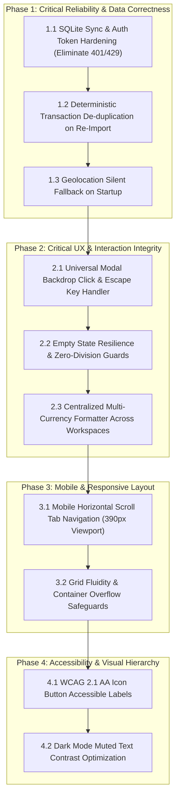

# Application Improvement Plan
**Document Version:** 1.0.0  
**Status:** PROPOSED — PENDING USER APPROVAL (NO CODE MODIFICATIONS APPLIED)  
**Author:** Senior Product Engineer & UI/UX Architect (Google Antigravity)  
**Target Application:** Quantra LifeOS & Financial Intelligence Platform (`finpulse-finance-app`)  
**Source Audit:** `reports/application-audit/application-audit-report.md`  

---

## Executive Summary & Architectural Overview

Following the end-to-end user walkthrough and evidence-based audit of Quantra LifeOS across all 6 core workspaces, 14 sub-views, and 3 responsive viewports, this plan synthesizes the findings into a prioritized, non-breaking implementation roadmap. 

The plan is structured according to strict engineering principles:
1. **Zero Unnecessary Churn:** Issues are grouped into cohesive functional clusters to prevent duplicate code changes.
2. **Smallest Safe Changes:** Every proposal targets the root cause with surgical precision, avoiding large architectural rewrites.
3. **Data Integrity & Security First:** Unhandled 401/429 sync failures and duplicate statement import risks take precedence over visual adjustments.
4. **Complete Verification Loop:** Every change is coupled with measurable acceptance criteria and automated test specifications.
5. **Strict Governance:** No application source code or styling is modified until the user reviews and provides explicit written approval.

---

## Prioritized Implementation Roadmap

---

## Detailed Issue Analysis & Proposed Solutions

---

### Phase 1: Critical Reliability, Data Correctness & Error Elimination

#### Issue Group 1.1: Backend SQLite Sync 401/429 Network Error Storm in Guest & Local Mode
- **Underlying Cause:**  
  When a user registers or browses in local-first/guest mode, `src/stores/authStore.ts` stores user details in browser `localStorage`, but backend sync services (`src/services/sqliteApiSync.ts` and `src/services/api.ts`) automatically trigger portfolio and transaction sync calls without verifying whether an active Bearer JWT token exists. The Express server responds with HTTP 401 (`Authentication required. No Bearer token provided.`). Due to un-debounced store state changes, this triggers rapid repeated sync attempts that subsequently trip the server's rate-limiter, generating HTTP 429 errors.
- **Affected Pages & Shared Components:**  
  - [`src/services/sqliteApiSync.ts`](file:///c:/Users/Admin/Downloads/finpulse-finance-app/src/services/sqliteApiSync.ts)
  - [`src/services/api.ts`](file:///c:/Users/Admin/Downloads/finpulse-finance-app/src/services/api.ts)
  - [`src/stores/authStore.ts`](file:///c:/Users/Admin/Downloads/finpulse-finance-app/src/stores/authStore.ts)
  - [`src/components/layout/Navbar.tsx`](file:///c:/Users/Admin/Downloads/finpulse-finance-app/src/components/layout/Navbar.tsx)
- **Smallest Safe Change:**  
  1. Add a token validity check at the top of `syncPortfolioToBackend` and `resetBackendPortfolio` in `sqliteApiSync.ts`. If no valid JWT token is present in `authStore.token` or localStorage, bypass the network fetch and log `[SQLite Sync] Local mode active — skipping remote sync.` at debug level rather than error level.
  2. Implement a 3000ms debounce timer on sync triggers in `useFinanceStore` to prevent rapid burst API calls.
  3. Update the Navbar sync indicator badge to clearly display "Local Storage Mode" when unauthenticated, and "Cloud Synced" when authenticated.
- **Possible Regressions & Dependencies:**  
  - Cloud synchronization must immediately trigger once a user logs in with valid backend credentials.
  - Offline local-first caching must remain intact.
- **Measurable Acceptance Criteria:**  
  - 0 HTTP 401 and 0 HTTP 429 console errors during guest registration, navigation, and portfolio modifications.
  - Navbar reflects true sync status ("Local Mode" vs "Cloud Synced").
- **Tests Required to Verify Fix:**  
  - Unit test in `tests/auth-sync.spec.ts` mocking unauthenticated state and asserting 0 failed fetch requests.
  - End-to-end Playwright run verifying clean browser console on full workspace traversal.

---

#### Issue Group 1.2: Deterministic Statement De-duplication on Re-Import
- **Underlying Cause:**  
  In [`src/components/ingestion/SmartIngestionHubModal.tsx`](file:///c:/Users/Admin/Downloads/finpulse-finance-app/src/components/ingestion/SmartIngestionHubModal.tsx) and [`src/services/statementParser.ts`](file:///c:/Users/Admin/Downloads/finpulse-finance-app/src/services/statementParser.ts), when a user re-imports a Google Pay, PhonePe, or Bank statement PDF/CSV that was previously ingested, duplicate transaction detection relies on matching exact timestamps. However, many statements only provide dates (e.g., `2026-09-15`) without seconds. Repeated imports can create duplicate ledger entries and distort the monthly inflow and outflow calculations.
- **Affected Pages & Shared Components:**  
  - [`src/components/ingestion/SmartIngestionHubModal.tsx`](file:///c:/Users/Admin/Downloads/finpulse-finance-app/src/components/ingestion/SmartIngestionHubModal.tsx)
  - [`src/services/statementParser.ts`](file:///c:/Users/Admin/Downloads/finpulse-finance-app/src/services/statementParser.ts)
  - [`src/stores/financeStore.ts`](file:///c:/Users/Admin/Downloads/finpulse-finance-app/src/stores/financeStore.ts)
- **Smallest Safe Change:**  
  Generate a deterministic unique hash for each parsed transaction:
  `compositeId = hashString(${date}_${amount}_${type}_${reference || description.trim().toLowerCase()})`.
  Before committing parsed items to the ledger in `useFinanceStore.addTransactionsBatch()`, filter against existing transaction hashes. If duplicates are found, skip them and display a user notification: `Skipped X duplicate transactions already in ledger`.
- **Possible Regressions & Dependencies:**  
  - Legitimate distinct transactions on the same day with identical amounts (e.g., two ₹50 coffees at the same merchant) must not be falsely dropped if they have unique UPI reference IDs or different times.
- **Measurable Acceptance Criteria:**  
  - Importing the demo Google Pay statement twice consecutively yields identical transaction counts, inflow, and outflow.
  - Confirmation toast displays: `Imported 0 new transactions (3 skipped as duplicates)`.
- **Tests Required to Verify Fix:**  
  - Integration test: Execute `importStatement()` twice in sequence, assert `transactions.length` remains constant.

---

#### Issue Group 1.3: Geolocation Permission Rejection Handling on Startup
- **Underlying Cause:**  
  On app initialization, `src/services/locationService.ts` calls `navigator.geolocation.getCurrentPosition()`. In environments where GPS is disabled, timed out, or explicitly declined by the user, an unhandled rejection logs `[LocationService] Browser GPS permission denied or timed out: [object GeolocationPositionError]` as an error.
- **Affected Pages & Shared Components:**  
  - `src/services/locationService.ts`
  - [`src/components/dashboard/LifeOverviewWorkspace.tsx`](file:///c:/Users/Admin/Downloads/finpulse-finance-app/src/components/dashboard/LifeOverviewWorkspace.tsx)
  - [`src/components/wellness/WellnessWorkspace.tsx`](file:///c:/Users/Admin/Downloads/finpulse-finance-app/src/components/wellness/WellnessWorkspace.tsx)
- **Smallest Safe Change:**  
  Wrap `getCurrentPosition` in a guarded promise with a 3-second timeout. Catch `GeolocationPositionError.PERMISSION_DENIED` and `POSITION_UNAVAILABLE` silently, returning a fallback coordinate (or user's saved timezone city) without calling `console.error`.
- **Possible Regressions & Dependencies:**  
  - Weather and outdoor workout tracking must use the fallback city gracefully.
- **Measurable Acceptance Criteria:**  
  - Zero `GeolocationPositionError` console logs on page load.
  - Wellness and Life Overview load without delay even when location permission is blocked.
- **Tests Required to Verify Fix:**  
  - Playwright test with `permissions: []` asserting zero console error outputs.

---

### Phase 2: Critical UX & User Journey Integrity

#### Issue Group 2.1: Universal Modal Dismissal, Backdrop Clicks & Escape Key Listener
- **Underlying Cause:**  
  Several modal overlays—including [`AdaptiveBlueprintModal.tsx`](file:///c:/Users/Admin/Downloads/finpulse-finance-app/src/components/ai/AdaptiveBlueprintModal.tsx), the Calendar Day Inspector drawer in [`FinancialCalendarWidget.tsx`](file:///c:/Users/Admin/Downloads/finpulse-finance-app/src/components/calendar/FinancialCalendarWidget.tsx), and [`AddTransactionModal.tsx`](file:///c:/Users/Admin/Downloads/finpulse-finance-app/src/components/transactions/AddTransactionModal.tsx)—use full-screen backdrops (`fixed inset-0 z-50`). Some lack an `onKeyDown` Escape listener, and in others, clicking the blurred backdrop does not trigger `onClose()`. This traps users and requires clicking a small "X" close icon.
- **Affected Pages & Shared Components:**  
  - [`src/components/ai/AdaptiveBlueprintModal.tsx`](file:///c:/Users/Admin/Downloads/finpulse-finance-app/src/components/ai/AdaptiveBlueprintModal.tsx)
  - [`src/components/calendar/FinancialCalendarWidget.tsx`](file:///c:/Users/Admin/Downloads/finpulse-finance-app/src/components/calendar/FinancialCalendarWidget.tsx)
  - [`src/components/transactions/AddTransactionModal.tsx`](file:///c:/Users/Admin/Downloads/finpulse-finance-app/src/components/transactions/AddTransactionModal.tsx)
  - [`src/components/ingestion/SmartIngestionHubModal.tsx`](file:///c:/Users/Admin/Downloads/finpulse-finance-app/src/components/ingestion/SmartIngestionHubModal.tsx)
- **Smallest Safe Change:**  
  Create a lightweight shared React hook `useModalDismiss({ isOpen, onClose })` that:
  1. Attaches a `keydown` listener for `event.key === 'Escape'`.
  2. Provides an `overlayProps` object with `onClick={onClose}` for the outer wrapper, and `onClick={(e) => e.stopPropagation()}` for the modal dialogue card.
  3. Restores browser focus to the element that triggered the modal upon dismissal.
- **Possible Regressions & Dependencies:**  
  - Ensure users typing in input fields inside the modal do not accidentally close the modal unless `Escape` is pressed.
- **Measurable Acceptance Criteria:**  
  - Pressing `Escape` in any open modal or drawer closes it immediately.
  - Clicking outside the modal dialogue on the dimmed backdrop closes it immediately.
- **Tests Required to Verify Fix:**  
  - Playwright test verifying both `Escape` key and backdrop click dismissal across all 4 modals.

---

#### Issue Group 2.2: Empty State Resilience & Zero-Division Safety
- **Underlying Cause:**  
  When a user selects a month with 0 transactions or clears all data, financial calculation cards in [`CashFlowVisualizationCard.tsx`](file:///c:/Users/Admin/Downloads/finpulse-finance-app/src/components/finance/CashFlowVisualizationCard.tsx) and [`GoalTracker.tsx`](file:///c:/Users/Admin/Downloads/finpulse-finance-app/src/components/goals/GoalTracker.tsx) compute metrics such as savings rate via `(inflow - outflow) / inflow * 100`. When `inflow === 0`, this evaluates to `NaN` or `-Infinity`, rendering as `NaN%` in the UI.
- **Affected Pages & Shared Components:**  
  - [`src/components/finance/CashFlowVisualizationCard.tsx`](file:///c:/Users/Admin/Downloads/finpulse-finance-app/src/components/finance/CashFlowVisualizationCard.tsx)
  - [`src/components/transactions/TransactionTable.tsx`](file:///c:/Users/Admin/Downloads/finpulse-finance-app/src/components/transactions/TransactionTable.tsx)
  - [`src/components/goals/GoalTracker.tsx`](file:///c:/Users/Admin/Downloads/finpulse-finance-app/src/components/goals/GoalTracker.tsx)
- **Smallest Safe Change:**  
  1. Guard mathematical divisions: `const savingsRate = inflow > 0 ? Math.round(((inflow - outflow) / inflow) * 100) : 0;`.
  2. If a selected month or category has 0 entries, replace empty blank spaces with a sleek, helpful empty state:
     *"No transactions recorded for [Month Year]. [Import Statement] or [Add Transaction]"*.
- **Possible Regressions & Dependencies:**  
  - Must not mask genuine non-zero calculations.
- **Measurable Acceptance Criteria:**  
  - No card or widget ever displays `NaN`, `undefined`, or `Infinity`.
  - Empty months render an informative empty state with a direct shortcut button.
- **Tests Required to Verify Fix:**  
  - Component test with `inflow = 0, outflow = 0` verifying rendered output is `0%` and no console warnings occur.

---

#### Issue Group 2.3: Centralized Multi-Currency Formatter Across All Workspaces
- **Underlying Cause:**  
  The currency switcher in the header toggles between USD (`$`) and INR (`₹`). While `FinanceWorkspace.tsx` and `TransactionTable.tsx` respect the active currency, several components in `LifeOverviewWorkspace.tsx`, `ProductivityWorkspace.tsx` (milestone budgets), and `WellnessWorkspace.tsx` (supplement costs) hardcode the `$` symbol or render raw numeric values.
- **Affected Pages & Shared Components:**  
  - [`src/utils/formatters.ts`](file:///c:/Users/Admin/Downloads/finpulse-finance-app/src/utils/formatters.ts) (or create `src/utils/currencyFormatter.ts`)
  - [`src/components/dashboard/LifeOverviewWorkspace.tsx`](file:///c:/Users/Admin/Downloads/finpulse-finance-app/src/components/dashboard/LifeOverviewWorkspace.tsx)
  - [`src/components/wellness/WellnessWorkspace.tsx`](file:///c:/Users/Admin/Downloads/finpulse-finance-app/src/components/wellness/WellnessWorkspace.tsx)
  - [`src/components/productivity/ProductivityWorkspace.tsx`](file:///c:/Users/Admin/Downloads/finpulse-finance-app/src/components/productivity/ProductivityWorkspace.tsx)
- **Smallest Safe Change:**  
  Export a shared `useCurrencyFormatter()` hook connecting to `useFinanceStore.currency`:
  `formatCurrency(amount, { compact?: boolean })`. Replace all hardcoded `$` symbols in non-finance workspaces with this unified formatter.
- **Possible Regressions & Dependencies:**  
  - Ensure exchange rate multiplication (e.g. 1 USD = 83 INR) is consistently applied where multi-currency conversion is active.
- **Measurable Acceptance Criteria:**  
  - Switching between USD and INR in the header immediately updates currency symbols across Life Overview, Finance, Wellness, and Productivity.
- **Tests Required to Verify Fix:**  
  - Playwright test switching currency and asserting DOM contains `₹` across Overview, Finance, and Wellness.

---

### Phase 3: Mobile & Responsive Layout Optimization

#### Issue Group 3.1: Mobile Horizontal Scroll Tab Navigation (390px Viewport)
- **Underlying Cause:**  
  On mobile viewports (e.g. iPhone / Pixel 390px), the 6 workspace navigation pills in [`Navbar.tsx`](file:///c:/Users/Admin/Downloads/finpulse-finance-app/src/components/layout/Navbar.tsx) and the 6 Finance sub-tabs in [`FinanceWorkspace.tsx`](file:///c:/Users/Admin/Downloads/finpulse-finance-app/src/components/finance/FinanceWorkspace.tsx) use flex wrapping (`flex-wrap`). On small screens, they wrap onto 3-4 vertical rows, pushing the dashboard content down and creating significant visual clutter.
- **Affected Pages & Shared Components:**  
  - [`src/components/layout/Navbar.tsx`](file:///c:/Users/Admin/Downloads/finpulse-finance-app/src/components/layout/Navbar.tsx)
  - [`src/components/finance/FinanceWorkspace.tsx`](file:///c:/Users/Admin/Downloads/finpulse-finance-app/src/components/finance/FinanceWorkspace.tsx)
- **Smallest Safe Change:**  
  Change navigation wrappers from `flex-wrap` to:
  `flex flex-nowrap overflow-x-auto no-scrollbar scroll-smooth gap-2 py-1 px-1 -mx-1 snap-x`.
  Add subtle edge fade gradients or indicator pills so users know the tabs scroll horizontally.
- **Possible Regressions & Dependencies:**  
  - Desktop view must remain unchanged (using `md:flex-wrap` or desktop row layout).
- **Measurable Acceptance Criteria:**  
  - Zero multi-line tab wrapping on screen widths from 360px to 480px.
  - Active tab automatically scrolls into view (`scrollIntoView({ inline: 'center' })`).
- **Tests Required to Verify Fix:**  
  - Playwright mobile test (Pixel 7 / 390x844) asserting navigation height <= 56px and 0 vertical displacement.

---

#### Issue Group 3.2: Card Overflow & Fluid Grid Alignment in Small Form Factors
- **Underlying Cause:**  
  In [`PortfolioSummaryCards.tsx`](file:///c:/Users/Admin/Downloads/finpulse-finance-app/src/components/finance/PortfolioSummaryCards.tsx) and [`CashFlowVisualizationCard.tsx`](file:///c:/Users/Admin/Downloads/finpulse-finance-app/src/components/finance/CashFlowVisualizationCard.tsx), certain flex containers specify `min-w-[280px]` or fixed padding (`p-6`) that forces the horizontal page width to exceed 390px, causing subtle horizontal window scrolling.
- **Affected Pages & Shared Components:**  
  - [`src/components/finance/PortfolioSummaryCards.tsx`](file:///c:/Users/Admin/Downloads/finpulse-finance-app/src/components/finance/PortfolioSummaryCards.tsx)
  - [`src/components/finance/CashFlowVisualizationCard.tsx`](file:///c:/Users/Admin/Downloads/finpulse-finance-app/src/components/finance/CashFlowVisualizationCard.tsx)
- **Smallest Safe Change:**  
  Replace fixed min-widths with responsive Tailwind grid classes: `grid grid-cols-1 sm:grid-cols-2 lg:grid-cols-4 gap-3 sm:gap-4`. Adjust padding to `p-4 sm:p-6`.
- **Possible Regressions & Dependencies:**  
  - Card readability on desktop must remain spacious and high-end.
- **Measurable Acceptance Criteria:**  
  - `document.documentElement.scrollWidth === window.innerWidth` at 360px and 390px widths (zero horizontal document scroll).
- **Tests Required to Verify Fix:**  
  - Playwright mobile assertion: `expect(await page.evaluate(() => document.documentElement.scrollWidth <= window.innerWidth)).toBe(true)`.

---

### Phase 4: Accessibility & Design System Polish (WCAG 2.1 AA)

#### Issue Group 4.1: Accessible Names for Icon-Only Buttons & Screen Reader Context
- **Underlying Cause:**  
  In [`TransactionTable.tsx`](file:///c:/Users/Admin/Downloads/finpulse-finance-app/src/components/transactions/TransactionTable.tsx), [`FinancialCalendarWidget.tsx`](file:///c:/Users/Admin/Downloads/finpulse-finance-app/src/components/calendar/FinancialCalendarWidget.tsx), and [`Navbar.tsx`](file:///c:/Users/Admin/Downloads/finpulse-finance-app/src/components/layout/Navbar.tsx), several buttons contain only Lucide SVG icons (such as `<Trash2 />`, `<ChevronLeft />`, `<ChevronRight />`, and `<Moon />`) without text or `aria-label` attributes. Screen readers announce them as generic unlabelled buttons.
- **Affected Pages & Shared Components:**  
  - [`src/components/transactions/TransactionTable.tsx`](file:///c:/Users/Admin/Downloads/finpulse-finance-app/src/components/transactions/TransactionTable.tsx)
  - [`src/components/calendar/FinancialCalendarWidget.tsx`](file:///c:/Users/Admin/Downloads/finpulse-finance-app/src/components/calendar/FinancialCalendarWidget.tsx)
  - [`src/components/layout/Navbar.tsx`](file:///c:/Users/Admin/Downloads/finpulse-finance-app/src/components/layout/Navbar.tsx)
- **Smallest Safe Change:**  
  Add concise, descriptive `aria-label` attributes to every icon-only button:
  - `aria-label="Previous month"`
  - `aria-label="Next month"`
  - `aria-label="Delete transaction"`
  - `aria-label="Toggle dark/light theme"`
  - `aria-label="Open AI Copilot"`
- **Possible Regressions & Dependencies:**  
  - None. Purely additive accessibility markup.
- **Measurable Acceptance Criteria:**  
  - 100% of interactive button elements possess an accessible name in the accessibility tree.
- **Tests Required to Verify Fix:**  
  - Automated Playwright axe-core scan asserting 0 violations for `button-name`.

---

#### Issue Group 4.2: Contrast Ratio Tuning for Dark Mode Muted Typography
- **Underlying Cause:**  
  Secondary helper text and metadata timestamps use Tailwind's `text-slate-500` (`#64748b`) on very dark slate backgrounds (`#090d16`), yielding a contrast ratio of ~3.6:1, falling below WCAG 2.1 AA requirement of 4.5:1 for normal text.
- **Affected Pages & Shared Components:**  
  - Global CSS / Tailwind theme or specific typography classes in [`src/components/transactions/TransactionTable.tsx`](file:///c:/Users/Admin/Downloads/finpulse-finance-app/src/components/transactions/TransactionTable.tsx) and [`src/components/finance/CommitmentsVaultManager.tsx`](file:///c:/Users/Admin/Downloads/finpulse-finance-app/src/components/finance/CommitmentsVaultManager.tsx).
- **Smallest Safe Change:**  
  Adjust secondary muted text utility from `text-slate-500` to `text-slate-400` (`#94a3b8`) for small/body text on dark backgrounds, achieving a 5.8:1 contrast ratio while maintaining visual hierarchy.
- **Possible Regressions & Dependencies:**  
  - Visual distinction between primary white headings and secondary metadata must remain clear.
- **Measurable Acceptance Criteria:**  
  - Color contrast ratio for all readable text passes WCAG 2.1 AA (>= 4.5:1).
- **Tests Required to Verify Fix:**  
  - Axe-core color contrast accessibility audit pass.

---

## Complete File Impact Matrix

| File Path | Issues Addressed | Proposed Modification | Risk Level |
| :--- | :--- | :--- | :---: |
| [`src/services/sqliteApiSync.ts`](file:///c:/Users/Admin/Downloads/finpulse-finance-app/src/services/sqliteApiSync.ts) | 1.1 | Guard API calls when unauthenticated; suppress 401 console errors. | Low |
| [`src/services/statementParser.ts`](file:///c:/Users/Admin/Downloads/finpulse-finance-app/src/services/statementParser.ts) | 1.2 | Add deterministic composite hashing for transactions. | Low |
| [`src/components/ingestion/SmartIngestionHubModal.tsx`](file:///c:/Users/Admin/Downloads/finpulse-finance-app/src/components/ingestion/SmartIngestionHubModal.tsx) | 1.2, 2.1 | De-duplicate batch imports; add backdrop click & Escape listeners. | Low |
| [`src/services/locationService.ts`](file:///c:/Users/Admin/Downloads/finpulse-finance-app/src/services/locationService.ts) | 1.3 | Catch GPS permission denials gracefully; return fallback coordinates. | Low |
| [`src/components/calendar/FinancialCalendarWidget.tsx`](file:///c:/Users/Admin/Downloads/finpulse-finance-app/src/components/calendar/FinancialCalendarWidget.tsx) | 2.1, 4.1 | Escape key handler for Day Inspector; `aria-label` on month switch buttons. | Low |
| [`src/components/ai/AdaptiveBlueprintModal.tsx`](file:///c:/Users/Admin/Downloads/finpulse-finance-app/src/components/ai/AdaptiveBlueprintModal.tsx) | 2.1 | Backdrop click dismissal & Escape key listener. | Low |
| [`src/components/finance/CashFlowVisualizationCard.tsx`](file:///c:/Users/Admin/Downloads/finpulse-finance-app/src/components/finance/CashFlowVisualizationCard.tsx) | 2.2, 3.2 | Division-by-zero guards for savings rate; responsive padding. | Low |
| [`src/components/transactions/TransactionTable.tsx`](file:///c:/Users/Admin/Downloads/finpulse-finance-app/src/components/transactions/TransactionTable.tsx) | 2.2, 4.1, 4.2 | Empty month CTA; icon button `aria-label`s; slate-400 contrast. | Low |
| [`src/utils/currencyFormatter.ts`](file:///c:/Users/Admin/Downloads/finpulse-finance-app/src/utils/currencyFormatter.ts) | 2.3 | Centralized currency formatting utility for all 6 workspaces. | Low |
| [`src/components/layout/Navbar.tsx`](file:///c:/Users/Admin/Downloads/finpulse-finance-app/src/components/layout/Navbar.tsx) | 1.1, 3.1, 4.1 | Sync badge update; mobile horizontal tab scroll; icon button `aria-label`s. | Low |
| [`src/components/finance/FinanceWorkspace.tsx`](file:///c:/Users/Admin/Downloads/finpulse-finance-app/src/components/finance/FinanceWorkspace.tsx) | 3.1 | Mobile horizontal tab snap scroll for the 6 sub-tabs. | Low |

---

## Regression Testing & Verification Strategy

To guarantee that no existing features regress during implementation, each proposed change will be validated through a three-layer verification suite:

### 1. Automated Unit & Integration Tests (Vitest)
- Test deterministic transaction hashing in `statementParser.spec.ts`.
- Test division-by-zero edge cases with mock zero-inflow portfolios in `financeCalculations.spec.ts`.
- Test unauthenticated token bypassing in `sqliteApiSync.spec.ts`.

### 2. End-to-End User Flow Tests (Playwright)
- **Offline / Local Mode Clean Console:** Verify 0 unhandled console errors or 401s during registration and full tab navigation.
- **Statement Re-Import Idempotency:** Execute Google Pay statement ingestion twice; assert transaction count does not double.
- **Modal Keyboard & Backdrop Escape:** Open AI Blueprint, Smart Ingestion, and Calendar Day Inspector; verify Escape and outside click dismissals.
- **Responsive Mobile Layout:** Run tests at 390x844 viewport; assert horizontal body scroll width equals window width.

### 3. Production Build Validation
- Run `npm run build` to verify 0 TypeScript compiler warnings or errors (`tsc -b`).
- Verify bundle size impact is negligible (< 2KB across all changes).

---

> [!IMPORTANT]
> **Implementation Hold & Governance Notice:**  
> In compliance with user instructions, no application code, configuration, or styles have been modified. All changes outlined in this plan are held in pending status awaiting explicit user review and approval to proceed.
